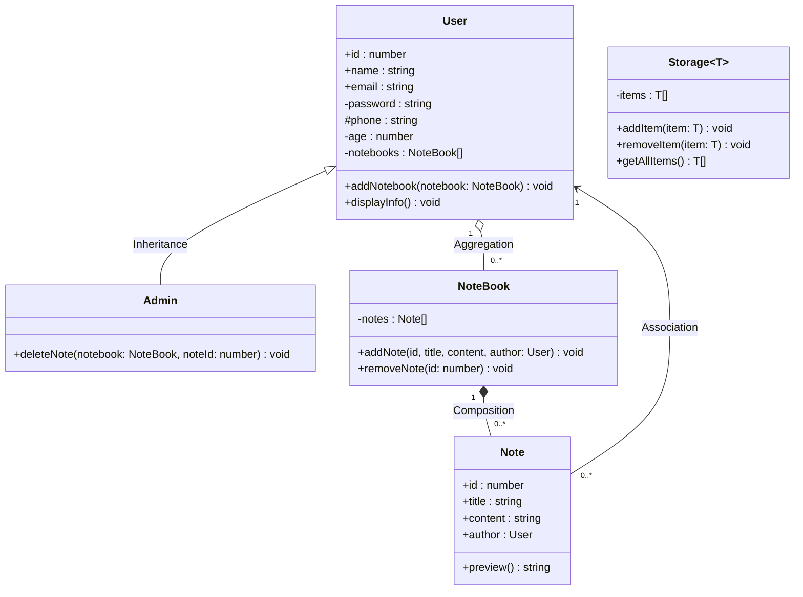

# UML Class Diagram

| Relationship | Classes | Symbol |
|---|---|---|
| Inheritance | Admin → User | hollow triangle |
| Composition | NoteBook ◆— Note | filled diamond |
| Aggregation | User ◇— NoteBook | hollow diamond |
| Association | Note → User | arrow |
